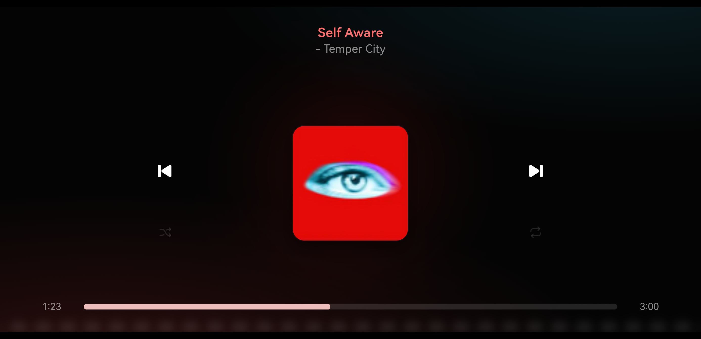

# Mobile Visualiser

A landscape now-playing screen for your phone, showing what your Linux laptop is playing.



- Colours taken from the album cover, always dark
- 30-bar cava visualiser behind everything, reacting to the laptop's audio
- Tap the cover to play/pause, swipe it to skip, drag the bar to seek
- Works with any MPRIS player (Spotify, browsers, mpv…) via `playerctl`

## Install

1. Run the [Halo](https://github.com/dsksnkz/halo) laptop server. It serves this screen and needs nothing extra beyond `playerctl` and `cava`.
2. Install `Visualiser.apk` from [Releases](../../releases).
3. Connect the phone by USB (debugging on) and pair from the Halo folder:

```bash
.venv/bin/python android/pair-phone.py --visualiser
```

Tap **Pair**. It then connects over Wi-Fi.

Build it yourself: `HALO_ANDROID_SDK=/path/to/sdk android/build.sh` (JDK 17).
